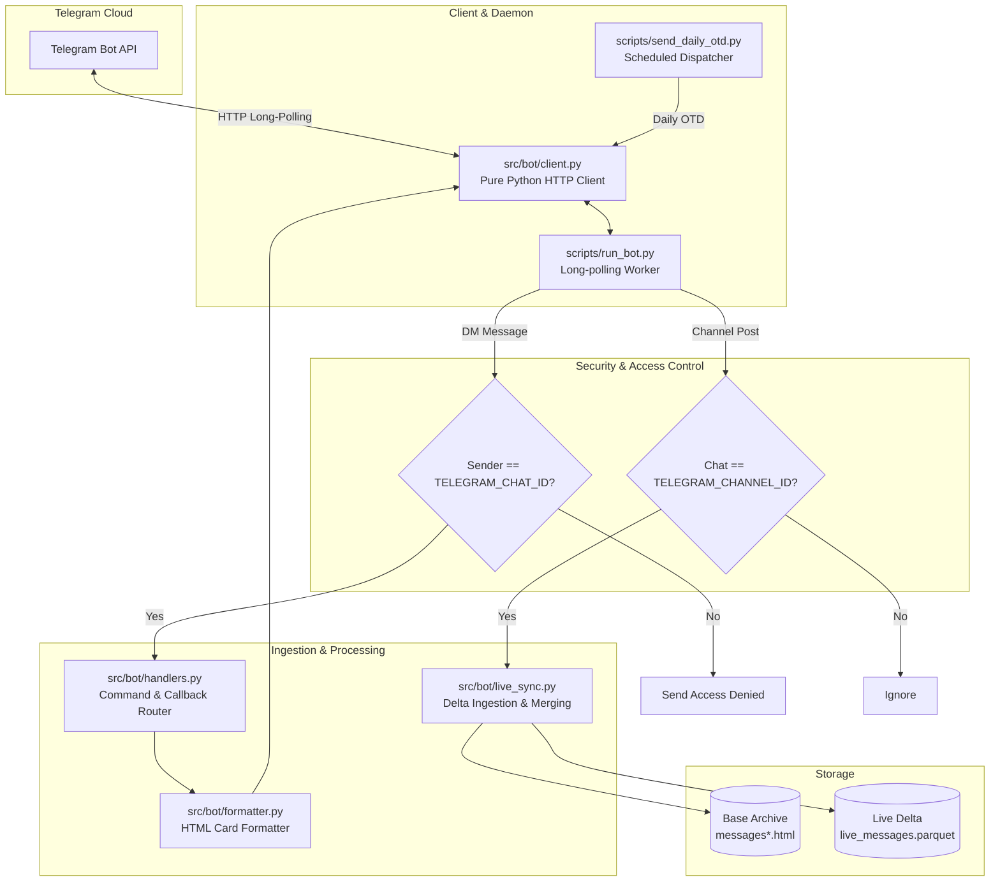

# System Architecture & Technical Specifications

This document outlines the internal architecture, data schemas, modular analytical engines, and system topology of `telegram-journal-analytics`.

For end-user setup and CLI usage instructions, see [README.md](README.md).

---

## 1. System Topology & Project Tree

```
telegram-journal-analytics/
├── src/
│   ├── parser.py          # Universal Telegram HTML parser & Parquet cache engine
│   ├── bot/               # Telegram Companion Bot & Live Channel Ingestion
│   │   ├── client.py      # Zero-dependency HTTP Bot API client (urllib.request)
│   │   ├── formatter.py   # Telegram HTML message formatting & 4000-char chunker
│   │   ├── handlers.py    # Command routing, callback dispatch, user whitelist
│   │   ├── live_sync.py   # Real-time channel ingestion & delta Parquet store
│   │   └── config.py      # Isolated .env configuration loader
│   ├── circadian/         # Biological & psychological rhythm models
│   │   ├── logic.py       # Pure domain metrics (hourly density, night-owl share)
│   │   └── visual.py      # Plotly dark-mode & Matplotlib visual generators
│   ├── lifecycle/         # Tag discovery, streamgraphs & lifespan categorization
│   │   ├── logic.py       # Tag counts, active spans, turnover matrix
│   │   └── visual.py      # Streamgraphs & lifespan Gantt charts
│   ├── otd/               # "On This Day" multi-year memory query engine
│   │   ├── logic.py       # Calendar queries, windowing, random lookup
│   │   └── visual.py      # Terminal formatting & HTML memory card preparation
│   ├── wrapped/           # Annual & all-time retrospective analytics engine
│   │   ├── logic.py       # Volume, reading metaphors, personas, fixations
│   │   └── visual.py      # Terminal retrospective deck & HTML story deck
│   ├── dashboard/         # Master unified dashboard aggregator & visuals
│   │   ├── logic.py       # Cross-domain aggregation & OTD fallback logic
│   │   └── visual.py      # Plotly chart embedding & dashboard rendering
│   └── renderer.py        # Centralized Jinja2 template loader & render engine
├── templates/             # Decoupled HTML/CSS/JS presentation templates
│   ├── dashboard.html     # All-in-one Master Dossier dark-mode dashboard
│   ├── wrapped.html       # Spotify Wrapped-style interactive story deck
│   ├── on_this_day.html   # Dark-mode On This Day multi-year memory cards
│   ├── circadian.html     # Circadian & habit HTML dashboard
│   └── tag_lifecycle.html # Streamgraph & tag lifespan HTML dashboard
├── scripts/
│   ├── run_all.py            # Master CLI runner for unified dashboard & all reports
│   ├── send_daily_otd.py     # CLI runner for scheduled Telegram OTD flashback push
│   ├── run_bot.py            # Long-polling interactive Telegram bot daemon
│   ├── setup_daemon.py       # macOS launchd background service manager
│   ├── get_chat_id.py        # Automatic Chat ID discovery & .env updater
│   ├── run_circadian.py      # CLI runner for Circadian analytics
│   ├── run_tag_lifecycles.py # CLI runner for Tag & Hobby lifecycles
│   ├── run_otd.py            # CLI runner for On This Day flashback
│   ├── run_wrapped.py        # CLI runner for Channel-Wrapped retrospective
│   └── generate_synthetic_export.py # Authentic mock Telegram export generator
├── tests/
│   ├── test_live_sync.py
│   ├── test_bot_client.py
│   ├── test_bot_formatter.py
│   ├── test_bot_config.py
│   ├── test_parser_and_circadian.py
│   ├── test_lifecycle.py
│   ├── test_otd.py
│   ├── test_wrapped.py
│   ├── test_dashboard.py
│   └── test_renderer.py
├── output/                # Generated interactive HTML dashboards and PNG charts (gitignored)
├── .env.example           # Template for bot secrets (gitignored)
├── environment.yml        # Conda environment definition
└── requirements.txt       # Pip dependencies
```

---

## 2. Core Architectural Patterns

### A. Strict Domain & Presentation Decoupling
Every analytical domain (`circadian/`, `lifecycle/`, `otd/`, `wrapped/`, `dashboard/`, `bot/`) is split into:
* **`logic.py`:** Pure Python algorithms with zero plotting or UI dependencies. Computes statistics, spans, matrices, and domain dataclasses. Can run headless in sub-second CLI passes or inside unit tests.
* **`visual.py`:** Dedicated rendering module converting domain dataclasses into Plotly figures, static Matplotlib charts, or Jinja2 template contexts.
* **`templates/`:** Standalone Jinja2 HTML templates styled with pure CSS glassmorphism, responsive CSS variables, and zero external font or tracking dependencies.

### B. Universal Ingestion & Auto-Invalidating Cache
The ingestion engine (`src/parser.py`) decouples parsing from export names:
1. Discovers and sequentially parses paginated Telegram Desktop exports (`messages.html`, `messages2.html`, ...).
2. Extracts message IDs, UTC/local timestamps, raw text, word/char counts, bracket tags (`[tag]`), reaction emojis, and photo/media wrap flags.
3. Compiles the DataFrame into `.cache/parsed_messages.parquet` for instant ~0.2s reloads.
4. **Auto-Invalidation:** On every run, the parser inspects `max(mtime)` of all HTML files. If any raw file has been modified or added, the Parquet cache automatically invalidates and re-indexes.

### C. Hybrid Storage: Base Archive + Live Delta Layer
To support real-time sync without requiring constant full HTML re-exports:
* **Base Ground Truth:** Historical reflections from `ChatExport_your_channel/`.
* **Live Delta Layer:** Captured live channel posts stored in `.cache/live_messages.parquet`.
* **Unified Merge Engine (`src/bot/live_sync.py`):**
  ```python
  unified_df = pd.concat([base_df, live_df], ignore_index=True)
  unified_df = unified_df.drop_duplicates(subset=["id"], keep="last").sort_values("timestamp")
  ```
  Deduplication by Telegram message `id` ensures that live post edits supersede older snapshots, and any future full manual export merges cleanly with zero duplicates.

---

## 3. Telegram Companion Bot Architecture



### Key Technical Specs:
* **Zero External Framework Dependencies:** Implemented using standard library `urllib.request`. Zero async framework lock-in (`python-telegram-bot` or `aiogram` bloat avoided).
* **Strict User Whitelist:** Private DM interactions are checked against `TELEGRAM_CHAT_ID`. Non-authorized users receive an immediate `Access Denied` card and are logged.
* **Defensive Message Chunking:** Telegram strictly enforces a 4,096-character limit per message. `formatter.py` escapes HTML special characters, truncates massive monolithic entries to 500 characters, and breaks multi-year flashbacks into chained chunks of $< 4,000$ characters.
* **macOS Background Service:** Managed via standard user `launchd` plist (`~/Library/LaunchAgents/com.kieran.telegram_journal_bot.plist`) with `KeepAlive: true` and unbuffered stdout logging to `output/bot.log`.
