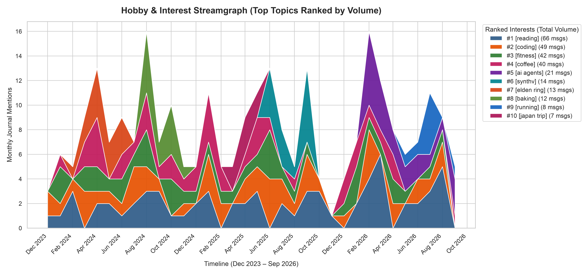
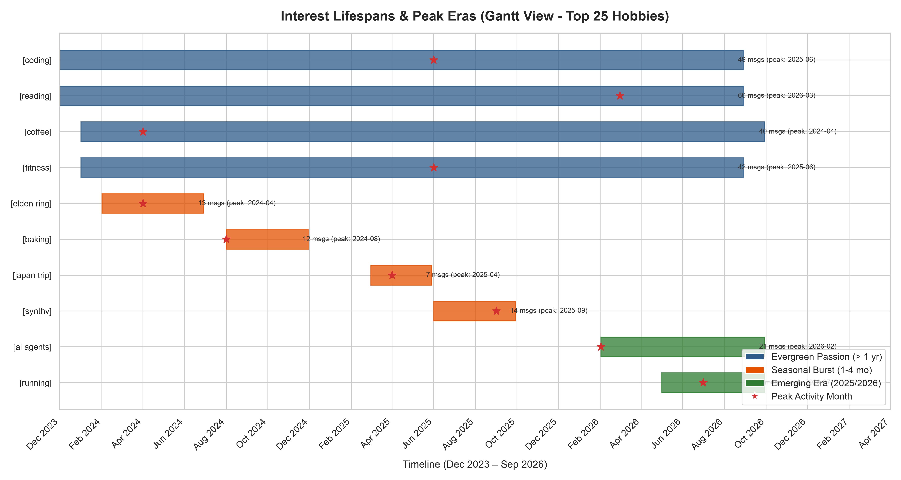
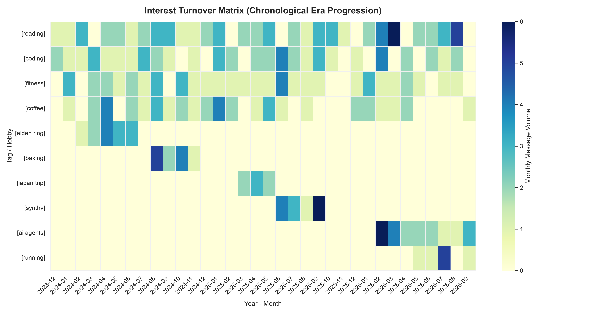
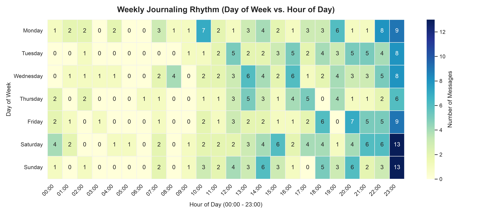
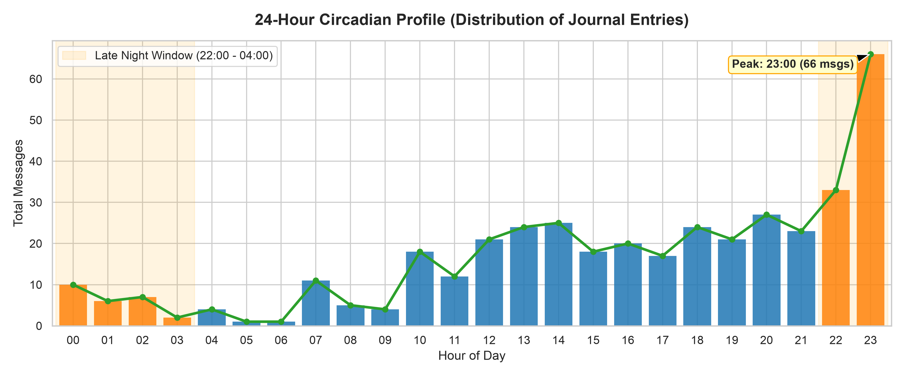
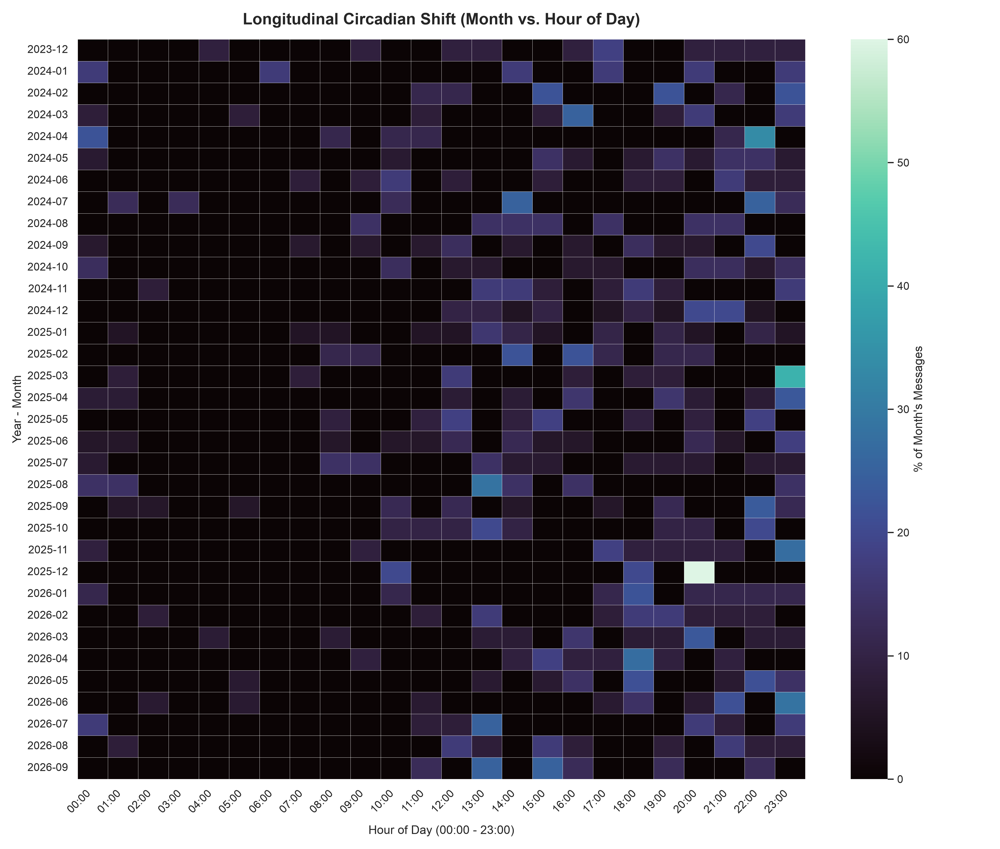

# Telegram Journal Analytics

Offline, privacy-first analytics and time capsule engine for personal Telegram channel exports.

---

## Interactive Demos (Synthetic Benchmark)

Interactive reports generated from a 400-message mock dataset. No server required; fully static HTML/JS.

| Module | Description | Live Demo | CLI Command |
| :--- | :--- | :--- | :--- |
| **Channel-Wrapped** | Annual & all-time Spotify Wrapped-style story deck | [wrapped.html](demos/wrapped.html) | `python -m scripts.run_wrapped` |
| **On This Day (OTD)** | Multi-year personal flashback for matching calendar days | [on_this_day.html](demos/on_this_day.html) | `python -m scripts.run_otd` |
| **Tag Lifecycles** | Streamgraph & lifespan categorization of bracket tags `[tag]` | [tag_lifecycle_report.html](demos/tag_lifecycle_report.html) | `python -m scripts.run_tag_lifecycles` |
| **Circadian Habits** | 24-hour distribution, weekly heatmaps & longitudinal shifts | [circadian_report.html](demos/circadian_report.html) | `python -m scripts.run_circadian` |

---

## Features & Visuals

### 1. Tag & Hobby Lifecycles
Extracts bracket tags (e.g. `[reading]`, `[fitness]`, `[f1]`) and classifies them into Evergreen passions, Seasonal bursts, and Emerging eras.







---

### 2. Circadian & Habit Heatmaps
Analyzes message timestamps to determine natural reflection hours, peak day of the week, and schedule shifts over time.







---

### 3. On This Day (OTD) Time Capsule
Surfaces what you wrote on today's calendar date across previous years. Includes active spans, photo indicators, and compact formatting.

```text
$ python -m scripts.run_otd --date 09-15

━━━━━━━━━━━━━━━━━━━━━━━━━━━━━━━━━━━━━━━━━━━━━━━━━━━━━━━━━━━━━━━━━━━━━━
📅 1 YEAR AGO (2025) · 4 messages · 1:40 AM -> 11:44 PM
──────────────────────────────────────────────────────────────────────
   1. [1:40 AM] Cooked dinner at home today instead of ordering takeout.
   2. [10:29 PM] 📷 [reading] Picked up a new paperback today during lunch break.
   3. [10:55 PM] Quick reminder to drink more water and get to sleep earlier tonight.
   4. [11:44 PM] [synthv] Exported the final audio mixdown, sounds balanced and clean.

━━━━━━━━━━━━━━━━━━━━━━━━━━━━━━━━━━━━━━━━━━━━━━━━━━━━━━━━━━━━━━━━━━━━━━
📅 2 YEARS AGO (2024) · 4 messages · 7:47 AM -> 2:35 PM
──────────────────────────────────────────────────────────────────────
   1. [7:47 AM] 📷 [coding] Finally resolved a stubborn caching bug that bugged me for days.
   2. [10:41 AM] [baking] Proofing dough overnight for fresh bread tomorrow morning.
   3. [11:48 AM] [reading] The plot twist in this chapter caught me completely off guard.
   4. [2:35 PM] Had a productive day clearing backlogged tasks and emails.
```

---

### 4. Channel-Wrapped Retrospective
Spotify Wrapped-style retrospective highlighting your annual or all-time writing volume, book page metaphors, longest streaks, circadian personas (e.g. *The Midnight Philosopher*), top fixations, and standout memories.

```text
═══════════ ✨ CHANNEL-WRAPPED RETROSPECTIVE: 2024 ✨ ════════════
  • Total Entries:       136 messages
  • Words Inscribed:     1,367 words (8,738 characters)
  • Real-World Metaphor: ~5.0 book pages (~7 min read)
  • Consistency:         104/366 active days (28.4%)
  • Archetype:           The Midnight Philosopher 🦉
  • Peak Reflection Hour:11:00 PM (24h: 23:00)
  • Top Fixations:       [reading] (21), [fitness] (19), [coffee] (19)
════════════════════════════════════════════════════════════════
```

---

## Quickstart

### 1. Setup Environment
```bash
# Using Conda
conda env create -f environment.yml
conda activate tele-journal

# Or using standard venv
python3 -m venv venv && source venv/bin/activate
pip install -r requirements.txt
```

### 2. Run on Synthetic Benchmark
```bash
# Generate 400 mock entries (Dec 2023 - Sep 2026)
python -m scripts.generate_synthetic_export --output-dir "ChatExport_sample"

# Run analytics against mock data
python -m scripts.run_wrapped --export-dir "ChatExport_sample" --year 2024
python -m scripts.run_otd --export-dir "ChatExport_sample"
python -m scripts.run_tag_lifecycles --export-dir "ChatExport_sample"
python -m scripts.run_circadian --export-dir "ChatExport_sample"
```

### 3. Run on Real Telegram Export
Export chat history in Telegram Desktop as HTML:
```bash
# Place export in repo and point to it
python -m scripts.run_otd --export-dir "path/to/ChatExport"
python -m scripts.run_otd --date 04-20 --window 2
python -m scripts.run_otd --random
```

### 4. Run Automated Tests
```bash
# 100% self-contained; passes without private data
python -m unittest discover tests
```

---

## Potential Future Features

- **Channel-Wrapped:** An annual retrospective summary (Spotify Wrapped style) highlighting your top fixations, most active reflection months, night-owl streaks, and personal milestones.
- **Telegram Bot Integration:** An automated companion bot that pushes daily "On This Day" flashback messages directly to your channel or DM, eliminating manual export steps.
- **Concern & Anxiety Evolution:** Longitudinal tracking of worries, stressors, and emotional themes over time to see how past challenges evolved and resolved.
- **"Ask Past You":** Semantic search and conversational Q&A (RAG) over your journal history to query what you thought or felt about specific topics in the past.

---

## Caching

It caches unless the export is changed.
